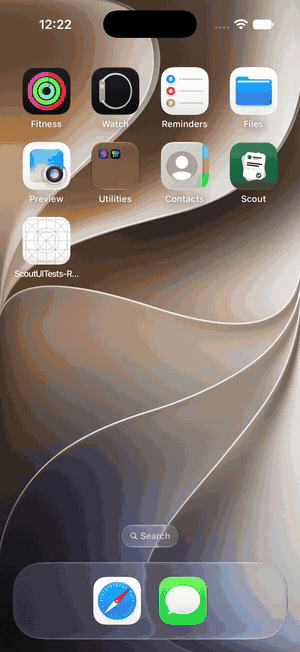
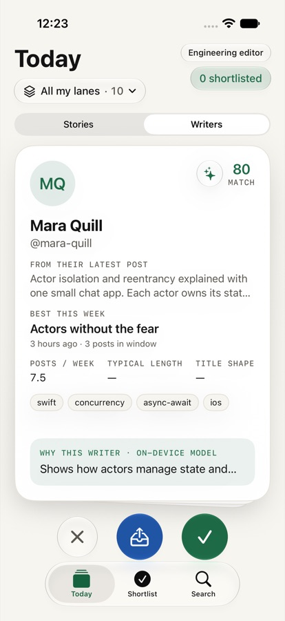
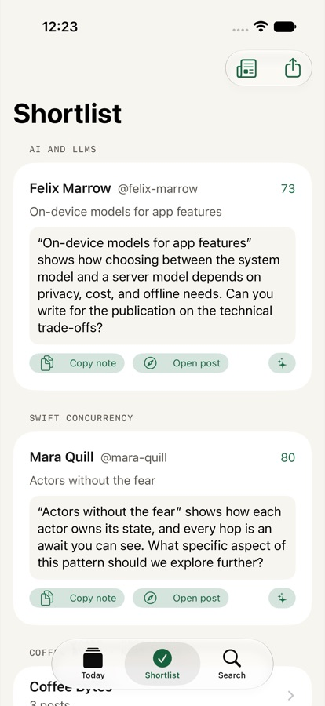
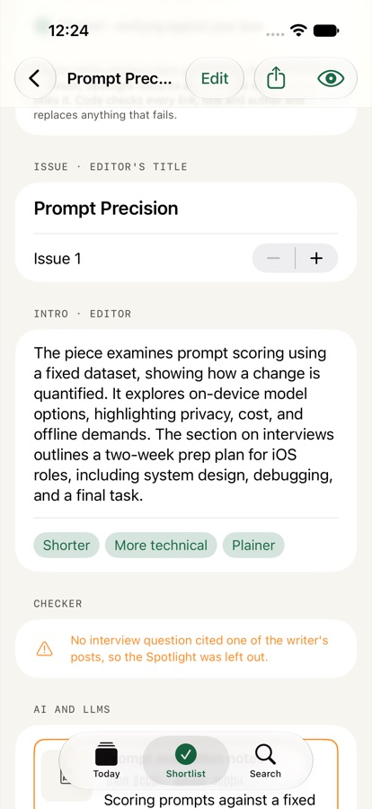
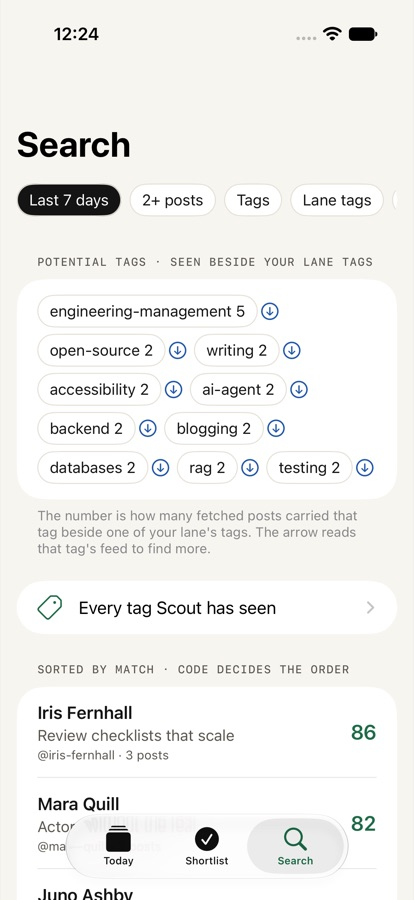
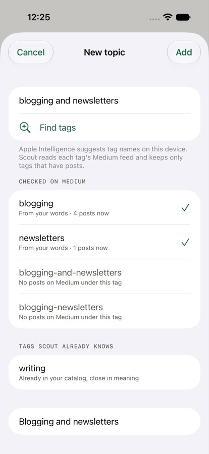

# Scout

A writer-scouting app for newsletter and publication editors, for iOS 27. Each day Scout reads
Medium's public RSS feeds for your lanes, ranks the writers in code, and deals them as a deck of
cards:

- swipe right to shortlist,
- swipe left to pass,
- swipe up to add their best post to the next newsletter issue.

Apple Intelligence runs on device. It writes a one-line "why this writer", the outreach notes and
the issue intro. It never decides who ranks where.

Scout grew out of MediumRSS, a tool I built in 2023 while editing Better Programming to scout Medium stories and authors for outreach and newsletter marketing. Claude helped me revisit and update it with on-device AI.

<p align="center"></p>

[Watch the 60-second demo (MP4)](docs/media/scout-demo.mp4). The demo and screenshots use fictional
writers from Scout's built-in demo data, not real people.

| Today | Shortlist | Issue | Search and tags | New topic |
| --- | --- | --- | --- | --- |
|  |  |  |  |  |

More: [Stories deck](docs/screenshots/02-stories.jpg) · [Issue preview](docs/screenshots/06-issue-preview.jpg) ·
[Tag catalog](docs/screenshots/08-tag-catalog.jpg) · [Siri card (rehearsal render)](docs/screenshots/11-siri-card.jpg)

**In one line:** code ranks, Apple Intelligence explains. Every score, count, link and order comes
from code; the on-device model writes sentences, and code checks each one before you see it.

**Open data only.** Scout reads public RSS feeds (Medium's official feeds, Hacker News, any blog). It
uses no Medium API and no account, and nothing you do leaves the device unless you export it.
Scout is an independent project and is not affiliated with or endorsed by Medium.

## Screens

- **Today**: the deck. Each card shows the writer's avatar (from their own feed), their best post
  this week, topic chips, a match score and the on-device "why" line. The pass, Issue and shortlist
  buttons use Liquid Glass.
- **Shortlist**: writers grouped by lane, each with an outreach note drafted on device. Notes are
  editable and never sent. Copy a note, open the post, or export the shortlist as Markdown or CSV.
- **Issue**: posts you swiped up, with LinkPresentation previews. Reorder them, edit notes, draft an
  intro, preview the rendered Markdown, then copy Markdown or share Markdown/HTML or an `llms.txt`.
- **Search**: SwiftData-backed filters (last 7 days, 2+ posts, tag, blocked), results ordered by a
  match score computed in code, Core Spotlight semantic search (`CSUserQuery`) over shortlisted
  writers, and pitch import (PDF or screenshot, read with Vision `RecognizeDocumentsRequest`).
- **Tags and topics**: every Medium tag on every fetched post is counted on device in a SwiftData
  catalog. Search shows *potential tags* (tags that keep appearing beside your lane's tags) and the
  whole catalog; **Explore** reads one tag's feed so the catalog grows. **New topic** turns any topic in
  plain words ("blogging and newsletters", "Apple tech") into a lane: the model suggests tag names,
  Scout reads each tag's Medium feed and keeps only tags that have posts.
- **Add a site**: paste any site; Scout finds its RSS or Atom feeds and adds one as a lane. For a
  writer's own site it reads `/llms.txt` (weekly) and shows what the site says about itself.
- **Siri**: "Scout today's new writers in Scout" shows an interactive card with the top four
  writers, plus Open deck and Shortlist all. "Show my shortlist in Scout" opens the shortlist.

## Role packs

A role pack is plain JSON (`.scoutpack`) that says what to read, how to rank it and what to make.
Pick one at first launch, switch packs in Settings, or import and share them.

| Pack | Reads | Output |
| --- | --- | --- |
| Engineering editor | Medium tags, Hacker News front page, Show HN, GitHub releases (Atom) | Markdown newsletter |
| Tech writer / newsletter | Medium publications and authors, Substack | Markdown and HTML |
| Illustrator / painter | Art blogs with open RSS (Colossal, Muddy Colors, Hyperallergic) | Moodboard |

The illustrator pack leads with images and matches by Vision feature-print distance to images you
kept, not by text embeddings. Instagram and Behance have no public feeds, so no pack claims them.

Swipes tune the active pack, in code (`Taste.swift`):

- each swipe decays every tag weight by 3%;
- a kept card adds 0.25 to its tags' weights, a passed card subtracts 0.15;
- weights stay within -1…1;
- a running mean of liked text embeddings (or liked image prints) adds a similarity signal.

Taste can move a score by at most 12 points for tags and 10 for similarity. Settings shows what Scout
has learned and can reset it.

## How the model is used

Every request goes through one `LanguageModelSession.DynamicProfile`, `ScoutProfile`. Its body
switches on the active pack and the mode (`scouting`, `issueWriting`, `pitchReading`, `asking`,
`tagging`, and the newsletter agents `curator`, `blurber`, `spotlight`, `editor`):

- each branch has its own instructions and tools: `recentPosts` (a writer's stored posts) for text
  packs, `imageNotes` (the feed's caption text, never pixels) for visual packs;
- each mode has its own temperature;
- history is trimmed with `historyTransform`, and tool calls are logged in Settings;
- each role pack has one Foundation Models **Skill** (its house style, from Apple's
  [`foundation-models-utilities`](https://github.com/apple/foundation-models-utilities)) offered only in
  prose-writing modes. Code chooses which pack's skill exists; the model only decides when to load it;
- model text follows the device language when the on-device model supports it; quoted evidence
  stays word for word from the feed.

### Newsletter agents

The Issue screen drafts a newsletter with four agents on device, then a fifth step in code:

1. **Curator** groups your picked stories into sections (it can only use the story IDs it is given).
2. **Blurber** writes one line per story from its feed text.
3. **Spotlight** introduces one shortlisted writer, with interview questions that must cite their posts.
4. **Editor** titles the issue and writes a short intro.
5. **Checker** (code) verifies every link, title and author against your data and drops anything that
   fails, for example a Spotlight whose questions cite no real post.

Code picks the branch; the model never chooses its own role. Writer statistics reach the model as a
typed `PromptRepresentable` value (`AuthorStats`).

## Who decides what

| Code decides | The on-device model writes |
| --- | --- |
| Match score, order, counts, dates | The "why this writer" sentence |
| Which post is "best this week" | Outreach note drafts |
| Titles, links, names, handles in exports | Issue intro and entry notes |
| A pitch's title and @handle | A pitch summary |

Everything the model writes passes `TextGuard` before it is shown:

- no digits and no links;
- no empty praise ("shows deep understanding"): a card line has to say what the post does;
- the "why" line must quote its evidence word for word from the feed;
- a pitch summary may not add numbers the pitch lacks.

Feed text is wrapped in `<feed>` tags, and the instructions tell the model not to follow anything
inside them. Without Apple Intelligence, cards show no "why" line and notes fall back to a template.

The match score is a fixed blend, built in `Matching.swift`:

| Signal | Weight | Source |
| --- | --- | --- |
| Semantic similarity to the lane's theme | 35% | On-device `NLEmbedding` |
| Topic overlap with the lane's tags | 30% | Feed categories |
| Posting frequency in the window | 20% | Post count |
| Recency | 15% | Latest post date |

## Does the ranking agree with an editor?

`EditorialRankingEvaluation` (Apple's Evaluations framework) scores 25 Better Programming submissions I
accepted (14) or passed on (11) as editor, using the deck's own code ranking, and reports the AUC: the
chance an accepted piece ranks above a passed one (0.5 is a coin flip).

| Lanes | AUC |
| --- | --- |
| Engineering editor pack | 0.24 |
| Tech writer pack | 0.39 |

Both are below a coin flip: matching a piece to a lane's topic does not predict an editor's taste,
and on this set it leans toward pieces I passed on. An on-device model judge scored 0.62 on the same
set in a separate experiment. Topic match finds candidates; it is not quality. The notes are private,
so the test reads them from a local folder and is skipped without them.

## Data

Scout uses Medium's official RSS feeds, which return the latest 10 stories each:

- `https://medium.com/feed/tag/<tag>`
- `https://medium.com/feed/@<handle>`
- `https://medium.com/feed/<publication>`

Medium's profile pages and JSON endpoints return 403, so Scout has no bios, follower counts, claps or
Twitter handles. Reading time appears only for posts from feeds that carry full text.

Feeds are fetched through a capped `TaskGroup` behind a `FeedCache` actor. Changing the lane or
window cancels a load in progress.

## Layout

- `Scout/`: the app, holding SwiftUI, SwiftData, App Intents, Spotlight and the Foundation Models
  sessions.
- `Packages/ScoutKit/`: feeds, scoring, export and role packs as a Swift package with no UI or
  storage dependencies, so other apps can import the same logic. See its README.

## Build

```bash
brew install xcodegen
```

```bash
xcodegen generate
```

```bash
xcodebuild -project Scout.xcodeproj -scheme Scout -destination 'platform=iOS Simulator,name=iPhone 17' test
```

Swift 6 language mode with complete concurrency checking.

ScoutKit's tests (87) run on macOS with `swift test` in `Packages/ScoutKit`. The app's tests cover the
SwiftData store, the tag catalog and the model profile.

Tests use Swift Testing for:

- the RSS parser,
- match scoring and ordering,
- the model-text guard,
- Markdown, HTML, llms.txt and CSV snapshots,
- pitch facts.

An XCUITest checks that swiping updates the shortlist. `ScreenshotTour` captures screenshots on live
data and `DemoTour` records the README demo on demo data when `TEST_RUNNER_SCOUT_SCREENSHOT_DIR` is set.

The app ships in English with a Hindi String Catalog (`Localizable.xcstrings`).

Debug-only launch arguments:

- `-demoData`: fictional writers in an in-memory store
- `-tab today|shortlist|search`
- `-siriCardStage`: renders the Siri card on a light platter; a rehearsal, not real Siri
- `-pack <id>` picks a role pack; `-choosePack` shows the onboarding picker again; `-stories` opens the Stories deck

## Credits

The deck's stacking is adapted from [Deckloom](https://github.com/anupamchugh/Deckloom). The Siri
intents follow [SiriCardKit](https://github.com/krispuckett/SiriCardKit)'s rules. Both are MIT; see
`THIRD_PARTY_NOTICES.md`.

## License

MIT
